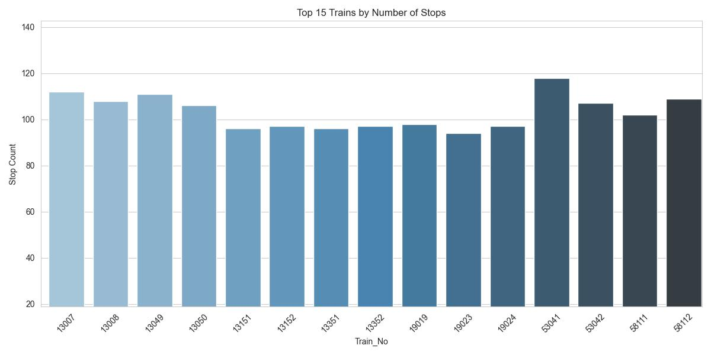
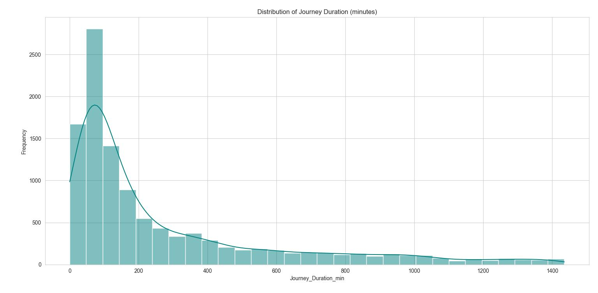
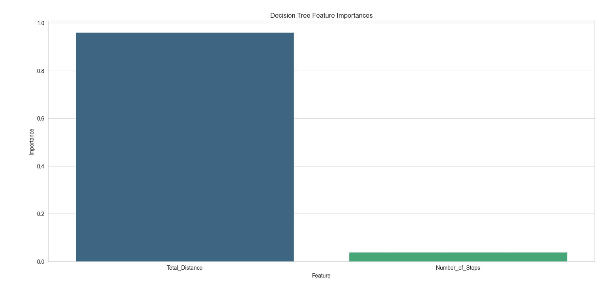

# Train Schedule Data Engineering Pipeline

A Python project that prepares train schedule data for analysis and basic journey-duration prediction. The workflow covers inspection, cleaning, transformation, aggregation, visualization, and two baseline regression models.

## What the pipeline does

1. Loads and inspects train schedule data, including column names, types, and sample rows.
2. Cleans records by handling missing values, removing duplicate rows, and standardizing arrival/departure times.
3. Transforms time fields and derives journey duration in minutes.
4. Builds train-level stop-count and distance tables, plus a train-by-station cross table.
5. Visualizes stop counts and journey-duration distributions.
6. Trains Linear Regression and Decision Tree Regressor models to estimate journey duration and saves predictions.

## Technology

Python, pandas, NumPy, Matplotlib, Seaborn, and scikit-learn.

## Run locally

1. Install Python 3.10 or later.
2. Create and activate a virtual environment, then install dependencies:

   ```bash
   python -m venv .venv
   # Windows PowerShell
   .\.venv\Scripts\Activate.ps1
   # macOS / Linux: source .venv/bin/activate
   pip install -r requirements.txt
   ```

3. Put the permitted train schedule CSV at `data/raw/train_schedule.csv`. The dataset is intentionally not included in this repository; use a dataset you are allowed to share and process.
4. Run the scripts in order from the repository root:

   ```bash
   python Source_Code/level1_load_and_inspect.py
   python Source_Code/level2_clean_dataset.py
   python Source_Code/level3_transform_dataset.py
   python Source_Code/level4_aggregations.py
   python Source_Code/level5_linear_regression.py
   python Source_Code/level6_decision_tree.py
   ```

Generated CSV files are written to `Outputs/`. The output data files are ignored by Git because some are large and can be regenerated from the input dataset.

## Repository structure

```text
Source_Code/   Six pipeline scripts, intended to run in order
Screenshots/   Project screenshots
data/raw/      Place the permitted input dataset here (not committed)
Outputs/       Generated tables and predictions (not committed)
```

## Screenshots

### Train stops



### Journey duration distribution



### Decision Tree feature importance



## Model notes

The models use number of stops and total distance as input features and journey duration as the target. The scripts use a reproducible train/test split (`random_state=42`). Treat these as learning baselines; evaluate them against an appropriate validation strategy before using predictions for real scheduling decisions.

## Data and sharing

The original dataset and generated CSV outputs are not included. Confirm that you have permission to share the source code, screenshots, and any data before publishing this repository publicly. Do not commit credentials, private records, or employer/client-confidential material.
